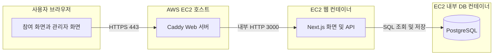
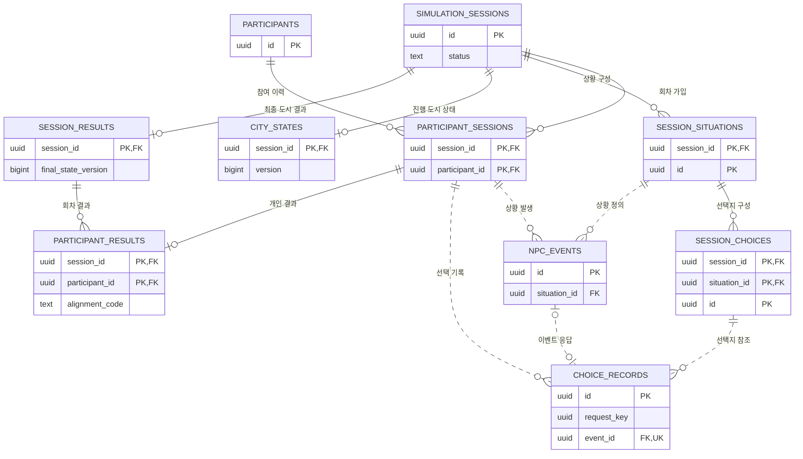

# 신구 엑스포 참가 보고서 초안 · SIM:US

| 항목 | 작성 내용 |
|---|---|
| 반 · 학번 · 이름 | [반] · [학번] · [이름] |
| 전시 프로젝트 | SIM:US · 관람객 참여형 3D 도시 시뮬레이션 |
| 전시 일자 · 본인 역할 | [실제 전시 일자] · [보드 제작에서 본인이 맡은 일] |

> **편집 메모**　본문은 11pt, 줄 간격 160%를 기준으로 옮겨 쓴다. 과제 안내의 ‘글자간격 160%’는 줄 간격으로 해석했다. 사진과 그림을 포함해 5~10쪽으로 맞추고, 파일명은 제출 형식에 따라 `반_학번_이름.docx` 또는 `반_학번_이름.hwp`로 지정한다. 예시는 `3c_20221234_홍길동.docx`다. 아래 대괄호는 실제 정보로 바꾼다. 기술 내용은 저장소 `d008811`과 프로젝트의 검증·운영 기록을 기준으로 정리했다.

## 1. 신구 엑스포를 하면서 느낀 점

엑스포 당시 SIM:US는 개발 중이었다. 그래서 이번 엑스포에서는 프로젝트 소개 보드만 제작했다. 노트북을 전시하거나 관람객이 직접 참여하는 시연을 진행하지 않았다.

SIM:US에서 기획한 체험은 여러 사람이 각자 휴대폰으로 일상 속 상황에 답하고, 그 선택이 모여 하나의 가상 도시를 바꾸는 것이다. 예를 들어 참여자 한 명이 내린 결정은 자신의 성향 결과에 반영되고, 여러 사람의 결정은 도시의 행복·치안·청결 수치에 함께 반영된다. [프로젝트 요구사항](docs/planning/requirements.md) · [참여 화면](web/src/app/participate/page.tsx)

**소감 초안**

> 보드를 준비하면서 ‘내가 고른 답이 우리 도시를 어떻게 바꿀까?’라는 질문으로 프로젝트를 돌아보았다. 시민증 등록이나 캐릭터 이동 같은 기능을 하나씩 설명해도, 내가 누른 선택지와 도시의 변화가 어떻게 이어지는지는 한눈에 보이지 않는다. 보드 한 장으로 기획 의도를 전하려면, 한 사람이 마주친 상황과 그 선택이 도시에 남기는 변화를 한 가지 예로 보여 주는 편이 이해하기 쉽겠다고 느꼈다.

## 2. 프로젝트 패널 앞 독사진 2장

| 사진 | 삽입 위치와 캡션 초안 |
|---|---|
| 사진 1 | **[실제 독사진 1 삽입]**　사진 1. 신구 엑스포 SIM:US 프로젝트 패널 앞에서 촬영한 사진. |
| 사진 2 | **[실제 독사진 2 삽입]**　사진 2. SIM:US 프로젝트 패널과 함께 촬영한 두 번째 사진. |

사진마다 본인과 프로젝트 패널이 보이는 독사진을 사용한다. 원본 비율을 유지하고, 한 장의 사진이 A4 반 쪽을 넘지 않게 조정한다. 두 장을 한 쪽에 위아래로 배치할 경우 각 사진을 가로 120mm, 세로 95mm 이내로 맞추면 캡션 공간을 확보하기 쉽다.

## 3. 현재 프로젝트 기술 스택

이하 기술 스택과 아키텍처, 구현 사례는 엑스포 이후 보고서를 작성하는 시점의 개발·검증 기록을 기준으로 정리했다.

| 구분 | 사용 기술 | SIM:US에서 하는 일 |
|---|---|---|
| 프런트엔드 | Next.js 16, React 19, TypeScript, CSS Modules | 시민증 입력, 모바일 선택지, 관리자, 참여 결과와 통계 화면을 구성한다. |
| Web 서버 | Caddy | EC2에서 브라우저의 HTTP·HTTPS 접속을 받고, TLS 인증서를 관리하며 요청을 내부 웹 애플리케이션으로 전달한다. |
| WAS 역할 | Node.js 24에서 실행되는 Next.js 서버 | 화면을 제공하며 API에서 참여자와 관리자 자격, 선택 제출, 점수 계산, 회차 상태와 DB 조회를 처리한다. |
| DB | PostgreSQL 16, `pg` | PostgreSQL은 회차별 참여·선택 원장·점수·결과를 저장한다. Next.js 서버는 `pg`를 통해 SQL을 실행하고 DB 트랜잭션을 사용한다. |
| 3D 도시 | Blender, Unity 6, C#, WebGL | Blender로 만든 도시 자산을 Unity 씬에 배치한다. Unity WebGL이 브라우저에서 NPC와 카메라, 도시 공간을 표시한다. |
| 빌드·배포 | Docker, Docker Compose, GitHub Actions, GHCR, AWS EC2 | GitHub Actions에서 배포 이미지를 검사하고 GHCR에 게시한다. EC2에서는 Compose로 웹 이미지와 내부 PostgreSQL 컨테이너를 실행한다. |

Web 서버는 외부 접속을 받아 애플리케이션으로 연결하는 입구에 해당한다. WAS는 입력을 검사하고 점수를 계산하는 등 서비스의 로직을 실행한다. SIM:US에서는 Caddy가 Web 서버 역할을, Node.js 기반 Next.js가 WAS 역할을 맡으며, PostgreSQL이 데이터를 보관한다. [웹 패키지 선언](web/package.json) · [Dockerfile](Dockerfile) · [운영 Compose](compose.prod.yaml) · [Unity 버전](unity/ProjectSettings/ProjectVersion.txt) · [배포 기록](docs/operations/ec2-ip-https.md)

## 4. 현재 프로젝트 아키텍처

**그림 1.** 운영 구성과 요청 흐름. 문서로 옮길 때는 Mermaid 미리보기에서 렌더링한 그림을 넣고, 아래 흐름 설명을 함께 사용한다.

1. 관람객이 QR을 통해 접속하면 브라우저의 요청은 EC2 호스트의 Caddy에 도달한다. Caddy가 HTTPS 연결을 처리하고 내부의 Next.js 컨테이너로 넘긴다. PostgreSQL은 내부 네트워크에서 Next.js와 연결된다. [운영 접속 구조](docs/operations/ec2-ip-https.md) · [Compose 설정](compose.prod.yaml)
2. Next.js는 모바일 참여 화면과 API를 제공한다. 참여 화면은 같은 사이트에서 Unity WebGL을 `iframe`으로 열고, API에서 읽은 본인 NPC의 경로와 위치 계산용 데이터를 `postMessage`로 전달한다. Unity는 브라우저에서 3D 도시를 그리고, 웹은 회차와 사용자 상태를 조회한다. [웹·Unity 계약](docs/contracts/web-unity-bridge.md) · [연동 코드](web/src/app/participate/unity/UnityCity.tsx)
3. 선택을 제출하면 그 요청은 Next.js로 전달되고, PostgreSQL에서 저장과 점수 갱신이 이뤄진다. 관리자도 같은 배포의 관리 화면에서 회차를 시작하거나 종료한다. GitHub Actions와 GHCR은 배포 이미지를 준비하는 경로다. 관람객의 요청은 위 그림의 운영 경로를 이용한다. [선택 API](web/src/app/api/choices/route.ts) · [회차 관리](web/src/lib/sessions/session-lifecycle.ts) · [이미지 게시 설정](.github/workflows/docker-publish.yml)

## 5. 현재 프로젝트 ERD

아래는 참가자 가입, 선택 제출, 도시 상태와 종료 결과에 필요한 핵심 테이블을 뽑은 ERD다. 회차는 한 번의 전시 체험 단위이며, 같은 참가자라도 회차마다 가입과 선택 기록이 따로 연결된다. PK는 행을 식별하는 기본 키, FK는 다른 테이블의 행을 참조하는 외래 키다. [초기 스키마](db/001_initial_schema.sql) · [이벤트 마이그레이션](db/011_npc_events.sql)

**그림 2.** 회차·참가자·선택·결과의 핵심 ERD. 그림에는 관계를 이해하는 데 필요한 대표 열을 표시했다. `event_id`가 비어 있는 과거 선택 기록도 보존되므로 이벤트와 원장 사이의 관계에 0을 포함한다.

| 관계 | 의미 |
|---|---|
| `participants` ↔ `simulation_sessions` | `participant_sessions`를 통해 다대다 관계를 연결한다. `(session_id, participant_id)`가 복합 기본 키다. 닉네임과 MBTI 등 회차 프로필 정보도 가입 기록에 둔다. |
| `session_situations` → `session_choices` | 하나의 상황에 여러 선택지가 속한다. 회차 ID가 포함된 키로 다른 회차의 선택지가 연결되는 것을 방지한다. |
| `npc_events` ↔ `choice_records` | `npc_events`가 특정 참가자에게 발생한 상황이고, `choice_records`가 수락한 제출이다. 현재 이벤트 방식에서는 `event_id`당 원장 한 건을 허용한다. 재전송은 회차·참가자·요청 키를 기준으로 확인한다. |
| `city_states` → 종료 시 `session_results` | 진행 중 도시 상태는 선택마다 갱신한다. 종료가 확정되면 해당 시점의 수치와 버전을 결과에 저장한다. 참가자별 성향 결과는 `participant_results`에 남는다. |

지역별 오염 상태와 개인 성향의 중간 점수는 각각 `region_states`, `participant_alignments`에 저장한다. 결과 공유와 푸시는 별도 테이블로 관리한다. [DB 스키마](db/001_initial_schema.sql) · [회차 프로필](db/009_participant_profiles.sql) · [결과 링크](db/007_result_links.sql) · [웹 푸시](db/008_web_push.sql)

## 6. 현재 프로젝트 구현 방법

### 시민증 등록과 회차 입장

참여 화면은 현재 열린 회차를 확인하고 닉네임, 학과, MBTI를 입력받는다. 참여자 쿠키가 남아 있는 브라우저에서는 이전 참여를 이어 갈 수 있다. 백엔드는 참여자 ID와 회차 ID를 가입 기록으로 연결한다. 가입한 참가자의 본인 NPC와 경로도 회차에 맞춰 제공한다. 같은 브라우저에서 다음 회차에 들어가면 새 회차의 점수가 별도로 쌓인다. [시민증 입력](web/src/app/participate/components/ProfileEntry.tsx) · [참여 상태](web/src/app/participate/hooks/useParticipation.ts) · [NPC 스냅샷](web/src/lib/npc/participant-npcs.ts)

### Unity 도시와 상황 화면 연결

웹은 해당 회차의 맵과 경로 버전을 확인한 뒤 WebGL을 연다. WebGL이 준비됐다는 메시지를 보내면 웹은 참가자의 NPC 정보를 넘기고, 이후 새 스냅샷으로 상태를 갱신한다. 상황과 접수 조건을 판단하는 기준은 서버에 있다. 기존 v002 개발 회차에서 실제 브라우저와 WebGL로 NPC 이동, 장소 이벤트, 선택, 이동 재개와 종료까지 확인한 기록이 있다. v003에서는 광장의 상자 상황 한 건을 로컬 테스트 대상으로 연결하고, 접근·선택·결과 확인·귀환을 API와 DB에서 검증했다. [웹·Unity 연결](web/src/app/participate/unity/UnityCity.tsx) · [v002 통합 검증](docs/verification/city-rebuild-v002-session-integration.md) · [v003 로컬 검증](docs/verification/v003-local-qa.md)

### 선택 저장과 도시 갱신

사용자가 선택지를 누르면 웹은 회차·상황·이벤트·선택지와 요청 키를 전송한다. 서버는 쿠키 인증과 접수 가능 여부를 확인하고, 어떤 이벤트가 실제로 활성화됐는지 검사한다. 선택을 받아들이면 원장과 개인의 성향 점수, 도시에 적용한 행복·치안·청결 변화, 해당하는 지역 오염 값을 같은 트랜잭션에서 기록한다. 도시 수치는 0~100으로 제한된다. 요청한 변화량과 실제로 적용한 변화량을 모두 보관해 상한이나 하한에 닿은 경우도 설명할 수 있다. [선택 저장 코드](web/src/app/api/choices/route.ts)

### 관리 화면과 회차 종료

관리자는 새 회차를 만들고 준비 상태를 확인한 뒤 시작한다. 회차가 끝나면 접수를 닫고 처리 중인 작업이 끝난 뒤 결과를 확정한다. 종료 중에 처리가 끊기면 내부 reconcile API가 `CLOSING` 상태를 확인해 다시 진행할 수 있다. 결과를 다음 회차와 분리해 두기 때문에 이전 도시 수치와 개인 결과가 유지된다. [관리자 화면](web/src/app/admin/page.tsx) · [회차 처리](web/src/lib/sessions/session-lifecycle.ts) · [종료 복구 검증](docs/verification/stage4-8-validation.md)

## 7. 구현하면서 어려웠던 점과 해결 방법

### 사례 1. EC2 공개 IP에서 HTTPS 접속 실패

새 EC2 환경에서 인증서가 발급된 기록이 있었지만, 최초 HTTPS 접속은 실패했다. IP 주소를 직접 사용하는 연결의 경우 클라이언트가 SNI를 보내지 않을 수 있다. SNI는 TLS 연결 초기에 클라이언트가 접속할 이름을 전달해 서버가 인증서를 선택하도록 돕는 정보다. 이 경우에도 Caddy가 올바른 인증서를 선택하도록 `default_sni`를 공개 IP로 지정했다. 설정 안내 이후 HTTPS 접속이 확인됐고, 운영 기록에는 DB 연결을 포함한 health 확인도 남아 있다. HTTP 80번은 HTTPS로 보내는 입구이자 인증서 검증에 쓰였고, 기록된 접속 장애는 TLS 단계에서 확인됐다. [EC2 HTTPS 운영 기록](docs/operations/ec2-ip-https.md)

### 사례 2. 응답 유실 뒤 새로고침하면 선택 재시도가 어려웠던 문제

불안정한 연결에서 사용자는 버튼을 눌렀지만 응답을 받지 못할 수 있다. 초기에는 미확인 제출 정보가 브라우저에 남아 있어도, 새로고침 후 화면의 선택 ID가 복원되지 않으면 재시도 버튼이 비활성화될 수 있었다. 브라우저가 저장한 선택 ID를 화면에 복원하고, 이미 접수된 응답은 서버 원장과 대조하도록 수정했다. 접수 여부가 불명확하면 기존 요청 키와 같은 입력으로 다시 요청한다. 서버는 먼저 이전 처리 기록을 확인해 이미 반영한 선택의 결과를 반환한다. 응답 유실, 새로고침, 오프라인에서 온라인으로 돌아오는 흐름을 Chromium에서 검증한 기록이 있다. [참여 화면 복원 코드](web/src/app/participate/hooks/useParticipation.ts) · [응답 유실 테스트 기록](docs/verification/stage4-8-validation.md)

### 사례 3. WebGL 초기 로딩과 포커스 문제

v003을 브라우저에서 시험할 때 초기 메모리 부족으로 도시가 열리지 않았다. 초기 WebGL 힙을 32MiB에서 512MiB로 설정한 빌드에서는 도시와 NPC가 로드됐다. 이후에는 웹의 시작 버튼에 포커스가 있는 동안 Unity 화면이 멈췄다가, 캔버스를 클릭하면 NPC 위치가 갱신되는 문제가 관측됐다. 대응으로 Unity 빌드 설정에 `runInBackground`를 반영했다. 서버 API와 새 빌드 검증 기록은 있으나, 버튼에 포커스를 둔 상태에서 화면의 이동·정지·재개까지 다시 성공했다는 기록은 확인되지 않았다. 이 사례를 통해 메모리 설정, 서버 상태, 화면 프레임을 나눠 관찰해야 원인을 좁힐 수 있음을 배웠다. [v003 독립 QA](docs/verification/v003-local-qa.md) · [WebGL 빌드 설정](unity/Assets/Editor/CityMasterplanV003LocalBuild.cs)

## 8. 아쉬웠던 점과 발전 방향

| 아쉬웠던 점 | 다음에 해 볼 개선 | 확인 방법 |
|---|---|---|
| 이번 엑스포에서는 보드만 제작해, 처음 접한 사람이 QR 접속부터 첫 선택까지 혼자 진행할 수 있는지 확인할 기회가 없었다. | 로딩, NPC 이동 중, 응답 가능 상태의 안내 문구를 다듬고, 접속 또는 제출 실패 시 다시 시도할 수 있는 경로를 화면에서 잘 보이게 한다. | 처음 체험하는 사람이 설명 없이 QR 접속부터 첫 선택까지 진행하는 모습을 관찰하고, 멈춘 단계와 질문을 기록한다. |
| v003의 대표 상황에 비해 나머지 상황의 실제 플레이와 기기별 WebGL 검증이 남아 있다. | 우선 전시에 필요한 대표 동선을 정하고, 씬의 접근 가능 여부와 NPC 정지 위치를 확인하는 절차를 상황별로 반복한다. Android와 iPhone에서 첫 화면부터 결과까지 시험하고, 로딩 시간·프레임 상태·실패 지점을 기록한다. | 각 상황별로 이동, 안내, 정지, 선택, 재개가 이어지는지 확인하고, 결과를 API 검증과 실제 화면 관찰로 나누어 남긴다. |
| 배포 성공 확인만으로는 전시 현장에서 회차가 정상적으로 돌아갈지 판단하기 어렵다. | 현장 QR 접속, 현재 회차 조회, 테스트 선택, 마감·결과 확인 순으로 리허설한다. Caddy 접속, 웹·DB 연결, 회차 설정의 확인 순서를 짧은 운영 문서로 만들어 공유한다. | 현장과 비슷한 네트워크·실기기에서 리허설하고, 담당자가 운영 문서만으로 문제가 생긴 단계를 찾아낼 수 있는지 확인한다. |

**마무리 소감 초안**

> 이번에 가장 아쉬웠던 점은 보드로 소개한 도시의 변화를 관람객이 직접 만들어 볼 기회가 없었다는 것이다. 다음 전시에서는 상황 하나라도 휴대폰에서 끝까지 체험할 수 있도록 준비하고 싶다. 첫 선택을 한 사람이 화면을 보고 무엇이 달라졌는지 스스로 설명할 수 있는지 확인해 보고 싶다.

---

### 제출 편집 체크

- **권장 8쪽 구성**　1쪽 제목·프로젝트 소개·소감, 2쪽 독사진 2장, 3쪽 기술 스택, 4쪽 아키텍처, 5쪽 ERD, 6쪽 구현 방법, 7쪽 문제와 해결, 8쪽 발전 방향과 마무리. 그림과 본문 분량에 맞춰 5~10쪽 범위에서 조정한다.
- 대괄호에 실제 전시 일자와 보드 제작에서 본인이 맡은 일을 넣고, 소감은 자신의 경험에 맞게 다듬는다. 본인이 수행한 기술 작업을 적을 때는 맡은 부분과 확인한 근거를 함께 덧붙인다.
- Mermaid 도식 두 개는 렌더링한 그림으로 삽입한다. 사진은 본인 독사진 2장으로 교체하고 크기를 확인한다.
- 제출본에 옮긴 뒤 본문 11pt와 줄 간격 160%, 실제 페이지 수, 지정 파일명을 확인한다.
